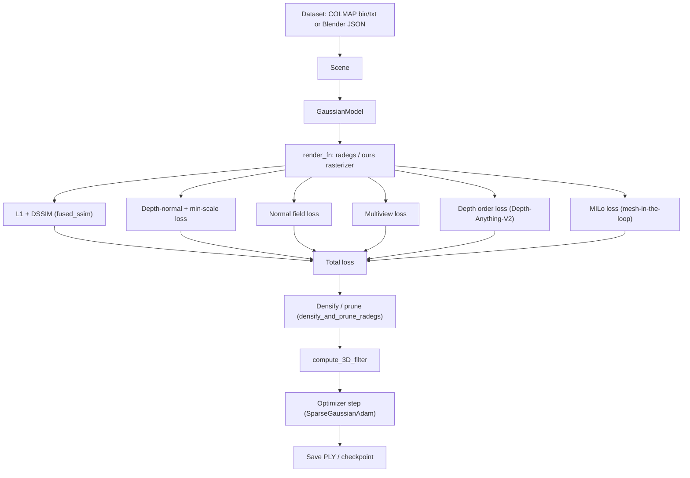

# Architecture

GaussianWrapping is a research codebase for 3D Gaussian Splatting (3DGS) with mesh extraction ("Gaussian wrapping") and a set of geometry regularizers. It is derived from the 3DGS / RaDe-GS / MILo line of work and extends it with a learnable normal field, mesh-in-the-loop (MILo) regularization, multiview consistency losses, depth-order supervision, and several mesh extraction backends (pivot-based marching tetrahedra and primal adaptive meshing).

This document is a module-by-module reference of the `gaussian_wrapping` package. It describes what each subsystem is responsible for, how the pieces plug into the training loop, and which rasterizer/regularizer to use when.

> Source of truth: `gaussian_wrapping/train.py`, `gaussian_wrapping/api.py`, `gaussian_wrapping/scene/gaussian_model.py`, `gaussian_wrapping/gaussian_renderer/`, `gaussian_wrapping/regularization/`, `gaussian_wrapping/install.py`, `.gitmodules`.

## High-level overview

The package is organized around a single training loop (`gaussian_wrapping/train.py`) that is also callable programmatically through `gaussian_wrapping.api.run_training`. The loop:

1. Loads a dataset (COLMAP or Blender/NeRF-synthetic) into a `Scene` of `Camera` objects.
2. Initializes a `GaussianModel` whose feature flags decide which regularizers are even possible (normal field, occupancy/SDF learning, appearance compensation, ...).
3. Renders each random training view with one of the pluggable rasterizers (`radegs`, `ours`, or the legacy `render_imp` path).
4. Accumulates a composite loss: photometric (L1 + DSSIM via `fused_ssim`), depth-normal consistency, minimum-scale, depth-order, multiview, normal-field, and mesh-in-the-loop terms.
5. Densifies/prunes Gaussians (RaDe-GS style by default), recomputes the 3D Mip filter, and steps the optimizer.
6. Periodically saves PLY point clouds and torch checkpoints.

Mesh extraction is a post-training step: `pivot_based_mesh_extraction.py` and `primal_adaptive_meshing_extraction.py` load a trained model, evaluate an SDF/occupancy field on pivot points, triangulate them (Delaunay), and run marching tetrahedra.

### Training loop data flow



## `gaussian_wrapping/scene/`

The scene package owns everything that exists before optimization: dataset parsing, camera construction, the Gaussian container, and mesh data structures.

### `dataset_readers.py`

Parses datasets into `CameraInfo` / `SceneInfo` named tuples. Two loaders are registered in `sceneLoadTypeCallbacks`:

- `readColmapSceneInfo(path, images, eval, llffhold=8, ply_output_path=None)` — looks for `sparse/` or `sparse/0/` (PGSR-style naming), tries binary `images.bin`/`cameras.bin` first and falls back to text `images.txt`/`cameras.txt`. Points are read from `points3D.bin` via `read_points3D_binary`. With `eval=True` every `llffhold`-th camera becomes a test camera. Only undistorted pinhole models are supported: `SIMPLE_PINHOLE` and `PINHOLE`; anything else raises `Colmap camera model not handled`.
- `readNerfSyntheticInfo(path, white_background, eval, extension=".png")` — reads `transforms_train.json` / `transforms_test.json` (Blender/NeRF-synthetic layout), converts OpenGL (Y up, Z back) camera axes to COLMAP (Y down, Z forward), and initializes from `points3d.ply` if present, otherwise from 100k random points in the [-1.3, 1.3] box.

There is no LLFF (poses_bounds.py) reader in this file; the `llff` argument is only used as the `llffhold` stride for COLMAP eval splits. `fetchPly` / `storePly` round-trip point clouds with `x/y/z`, `nx/ny/nz`, `red/green/blue` attributes (normals are written as zeros).

### `colmap_loader.py`

Low-level COLMAP binary/text parsers imported by `dataset_readers.py`: `read_extrinsics_binary`, `read_intrinsics_binary`, `read_extrinsics_text`, `read_intrinsics_text`, `read_points3D_binary`, `read_points3D_text`, and `qvec2rotmat`. It is a direct descendant of the 3DGS loader and has no GaussianWrapping-specific logic.

### `cameras.py`

- `Camera(colmap_id, R, T, FoVx, FoVy, image, gt_alpha_mask, image_name, uid, trans, scale, data_device)` — an `nn.Module` holding the GT image (clamped, on `data_device`), an optional `gt_mask` (alpha mask, kept separate from the image), `zfar=100.0` / `znear=0.01`, and precomputed CUDA tensors: `world_view_transform`, `projection_matrix`, `full_proj_transform`, `camera_center`. It also derives pinhole intrinsics from the FoV: `Fx`, `Fy`, `Cx = (W-1)/2`, `Cy = (H-1)/2`, and exposes a `gray_image` property (0.299/0.587/0.114 luma).
- `MiniCam(width, height, fovy, fovx, znear, zfar, world_view_transform, full_proj_transform)` — the lightweight camera used by the interactive GUI path (`network_gui`).

Resolution handling and mask loading live in `utils/camera_utils.py` (`loadCam`, `cameraList_from_camInfos`), not here; `Camera` just receives the already-resized image and mask.

### `gaussian_model.py`

The central container. Signature:

```python
GaussianModel(sh_degree, use_mip_filter=False, learn_occupancy=False,
              use_radegs_densification=False, use_appearance_network=False,
              n_gaussian_features=0, n_pivots_per_gaussian=9,
              use_unbounded_opacity=False, use_exposure_compensation=False)
```

Core tensors: `_xyz`, `_features_dc`, `_features_rest`, `_scaling`, `_rotation`, `_opacity`, plus `max_radii2D`, `xyz_gradient_accum`/`denom` (and `_xyz_gradient_accum_abs`/`_abs_max` when RaDe-GS densification is on), and `filter_3D` (the Mip-Splatting 3D filter).

Feature flags:

- `sh_degree` — max spherical-harmonics degree; `active_sh_degree` is bumped every 1000 iterations by `oneupSHdegree()`.
- `use_mip_filter` — enables `get_scaling_with_3D_filter` / `get_opacity_with_3D_filter` (Mip-Splatting-style covariance dilation) and `compute_3D_filter(cameras)`, which projects every Gaussian into every training camera and stores `distance / focal_length * sqrt(0.2)` per point.
- `learn_occupancy` — adds `_base_occupancy` (frozen, initialized by depth fusion) and `_occupancy_shift` (learned). `set_occupancy_mode("occupancy_shift")` must be called before `get_occupancy` / `get_occupancy_logit` / `get_sdf` work; `get_sdf` is simply `-get_occupancy_logit` (the "Object as volumes" convention).
- `use_appearance_network` — GOF-style decoupled appearance: an `AppearanceNetwork(3+64, 3)` plus per-camera 64-d embeddings. Mutually exclusive with exposure compensation (asserted in the constructor).
- `n_gaussian_features` — 0 (off), 1 (normal = smallest Gaussian axis, sign learned), or 4 (3 direction components + 1 sign). `convert_features_to_normals()` turns these into per-Gaussian normals; `reset_normal_features(reset_directions, reset_signs)` re-initializes them (directions reset to the shortest axis).
- `n_pivots_per_gaussian` — number of pivot points attached to each Gaussian (9 = 8 box corners + center, used for tetrahedral meshing; 2 = front/back along the normal).
- `use_radegs_densification` — enables the GOF/RaDe-GS densification path: `add_densification_stats_radegs`, `densify_and_clone_radegs`, `densify_and_split_radegs`, and `densify_and_prune_radegs(max_grad, min_opacity, extent, max_screen_size, use_abs_grad, viewpoint_cameras)`, which uses a quantile of the absolute-gradient accumulator as the split/clone threshold. With `use_unbounded_opacity`, pruning uses `get_average_contribution` over all training cameras instead of raw opacity.
- `use_unbounded_opacity` — switches the opacity activation from `sigmoid` to `exp` (log-space opacities) and replaces opacity with the analytic per-camera contribution `get_contribution(viewpoint_camera)` at render time.
- `use_exposure_compensation` — PGSR-style per-camera 2-parameter exposure embeddings (`initialize_exposure_compensation(num_cameras)`), consumed by `L1_loss_appearance`.

Other important members: `create_from_pcd(pcd, spatial_lr_scale)` (initializes from a `BasicPointCloud`, scales from `simple_knn.distCUDA2`), `training_setup(opt)` (builds the Adam/SparseGaussianAdam optimizer with per-parameter LRs), `capture()`/`restore()` (checkpoint tuples whose layout depends on the feature flags), `save_ply`/`load_ply` (the PLY format below), `get_tetra_points(...)` (builds 9 pivot points per Gaussian from a scaled/rotated box), and the legacy Mini-Splatting2 culling/clone helpers (`visibility_culling`, `aggressive_clone`, `culling_with_clone`, `importance_pruning`, `depth_reinit`) which are only used by the `render_imp`/`render_simp` path.

**PLY format.** `save_ply` writes `x y z nx ny nz f_dc_* f_rest_* opacity scale_* rot_*` and then, conditionally: `filter_3D` (mip filter), `base_occupancy_*` + `occupancy_shift_*` (learned occupancy), and `gaussian_features_*` (normal field). `load_ply` infers `use_mip_filter`, `learn_occupancy`, and `use_gaussian_features` from whichever attributes are present, so a single PLY fully determines the model configuration.

### `mesh.py`

A self-contained differentiable mesh library (no PyTorch3D dependency for the core ops):

- `Meshes(verts, faces, verts_colors=None)` — the workhorse: `face_normals`, `vertex_normals`, `edges`, `laplacian`, `cotangent_laplacian`, `submesh`, `angle_defect`, `return_triangle_areas`, plus edge/face adjacency helpers.
- Mesh losses used by the regularizers: `laplacian_smoothing_loss`, `normal_consistency_loss`, `compute_qem_loss` / `get_error_quadrics` / `vstars_from_quadrics` (quadric error metrics for decimation-style objectives), `v_star_attraction_loss`, `attract_pivots_along_mesh_edges_loss_fn`.
- `return_delaunay_tets(points, method="tetranerf")` — Delaunay tetrahedralization of pivot points (delegates to the `tetra_triangulation` submodule).
- Rendering: `MeshRasterizer` / `MeshRenderer` / `ScalableMeshRenderer` built on `nvdiffrast`, returning RGB, depth, and normals; used by `texture_mesh.py` and the MILo mesh-depth/normal losses.

### `appearance_network.py`

`AppearanceNetwork(num_input_channels, num_output_channels)` — a small CNN (conv → 4 `UpsampleBlock`s with `PixelShuffle(2)` → bilinear upsample → conv → sigmoid) that maps a concatenated (rendered RGB, 64-d appearance embedding) tensor to a corrected RGB image. Used only when `use_appearance_network=True`.

## `gaussian_wrapping/gaussian_renderer/`

All rasterizers share the same calling convention — `render_fn(viewpoint_camera, pc, pipe, bg_color, kernel_size=0.0, scaling_modifier=1.0, require_coord=False, require_depth=True, colors_precomp=None)` — and return a dict. The training loop only relies on the keys below, so rasterizers are interchangeable from `train.py`'s point of view (this is what `resolve_rasterizer` exploits).

| Key | Meaning |
| --- | --- |
| `render` | RGB image `(3, H, W)` |
| `expected_depth` / `median_depth` | expected (alpha-weighted mean) and median (first-surface) depth `(1, H, W)` |
| `normal` | rendered surface normal `(3, H, W)` |
| `viewspace_points` | screen-space means with `retain_grad()` for densification |
| `visibility_filter` | `radii > 0` boolean mask |
| `radii` | screen-space radii |
| `mask`, `expected_coord`, `median_coord` | alpha mask and 3D coordinate maps (RaDe-GS only) |

### `__init__.py`

The legacy Mini-Splatting2 path: `render_imp`, `render_simp`, `render_depth`, `render_full`, `render_isosurface`, all built on `diff_gaussian_rasterization_ms`. `render_imp` returns `render`, `viewspace_points`, `visibility_filter` (as indices, not a mask), `radii`, and `area_max`; it has no depth/normal outputs, so it cannot drive the geometry regularizers. It is used by the interactive GUI, by `api.GaussianWrappingScene` imports, and by the Mini-Splatting2-style culling helpers on `GaussianModel`. `network_gui.py` implements the socket server (`init`, `try_connect`, `receive`, `send`) that lets the SIBR viewer drive rendering mid-training.

### `radegs.py`

`render_radegs(...)` / `integrate_radegs(...)` on top of `diff_gaussian_rasterization` (the RaDe-GS rasterizer). `render_radegs` is the most complete renderer: it returns `render`, `mask`, `expected_coord`, `median_coord`, `expected_depth`, `median_depth`, `normal`, `viewspace_points`, `visibility_filter`, `radii`. `integrate_radegs(points3D, ...)` calls `rasterizer.integrate` to accumulate alpha/color/SDF at arbitrary 3D points (GOF-style), returning `alpha_integrated`, `color_integrated`, `point_coordinate`, `point_sdf`. Use this rasterizer when you need both expected and median depth and coordinate maps (e.g. the unmasked depth-normal loss).

### `ours.py`

`render_ours(...)` / `integrate_ours(...)` on top of `diff_gaussian_rasterization_ours`. The custom rasterizer returns `render`, `radii`, a single `rendered_median_depth`, alpha, and normals; `render_ours` reports it as both `expected_depth` and `median_depth` (they are the same tensor) and leaves `mask`/`expected_coord`/`median_coord` as `None`. Because of that, `train.py` forces `mask_depth_normal=True` when `--rasterizer ours` is selected (the masked depth-normal loss only needs median depth). Also provides `sample_depth_with_ours` and `sample_depth_and_normal_in_view` for querying depth/normals at arbitrary 3D points — used by the MILo and snapping regularizers.

### `sof.py`

The "SOF" (surface-oriented field) experimental rasterizer on `diff_gaussian_rasterization_sof`. `render_sof` packs 10 channels into one buffer (RGB, normal, expected/median depth, occupancy field, distortion map, extent loss) and additionally returns `occ_field`, `distortion_map`, and `extent_loss`. The rest of the file is occupancy evaluation machinery used at extraction time: `evaluate_vacancy_sof`, `evaluate_vacancy_sof_fast`, `evaluate_occupancy_field_sof(_frustum)`, `compute_transmittance`, `integrate_sof(_)` — these take explicit `splat_args` (sort order, transmittance threshold, alpha early stop) and frustum near/far. It is the backend for the `exact_computation` SDF mode in `pivot_based_mesh_extraction.py`, but `primal_adaptive_meshing_extraction.py` explicitly refuses it ("Always use the Ours rasterizer").

**Which one when.** `radegs` is the default training rasterizer (full depth/coord outputs, well-tested). `ours` is the custom rasterizer required for primal adaptive meshing and recommended for masked depth-normal training. `sof` is research/extraction-only. `render_imp` is legacy/GUI-only.

## `gaussian_wrapping/regularization/`

This package holds the math for each regularizer; the `regularizer/` subpackage holds the training-loop adapters (`initialize_*` / `compute_*` / `reset_*`) that `train.py` calls. YAML configs live in `gaussian_wrapping/configs/<regularizer>/<name>.yaml` and are loaded by `train.load_regularization_configs` — see [Regularization configs](regularization-configs.md).

### `normal_field.py`

Geometry for the learnable normal field: `get_gaussian_std_in_direction(directions, gaussians, ...)` (Gaussian extent along arbitrary directions), `get_pivots_from_normals(gaussians, normals, std_factor, return_scales)` (front/back pivot pairs offset along the normal by `std_factor * std`), and `get_signed_distance_to_depthmap(depth, points, camera, ...)` (project points, interpolate depth, return signed distance + validity mask). These are shared by the normal-field regularizer, MILo, and the extraction scripts.

### `multiview.py` and `multiview_gggs.py`

Two implementations of patch-based multiview consistency (MVS-style). `multiview.py` provides `compute_nearest_cameras(train_cameras, multi_view_max_angle, ...)`, homography warping (`patch_warp`), and `lncc` (local normalized cross-correlation) over depth-reprojected patches; `compute_multiview_losses` scores rendered depth against neighboring views. `multiview_gggs.py` is the Geometry-Grounded-Gaussian-Splatting variant built on the `warp-patch-ncc` CUDA kernel with a `PatchMatch` class; it is the faster path used when the GGGS submodule is available. Both are wrapped by `regularizer/multiview.py`.

### `sdf/`

- `depth_fusion.py` — TSDF fusion of rendered depth maps: `AdaptiveTSDF` (point-based TSDF with `integrate`, truncation margin, binary-opacity option), `evaluate_sdf_values` / `evaluate_mesh_occupancy` / `evaluate_mesh_colors(_all_vertices)` (evaluate the fused field or vertex colors at arbitrary points), `get_depth_fused_tsdf`, `fused_depth_with_mesh_feedback`, `frustum_cull_mesh`, and the occupancy↔SDF conversions (`convert_sdf_to_occupancy`, `convert_occupancy_to_sdf`, `get_pivots_occupancy`, `get_pivots_sdf`). This is what initializes `_base_occupancy` and what colors extracted meshes.
- `integration.py` — rasterizer-based SDF evaluation without an explicit TSDF: `evaluate_sdf_values`, `evaluate_cull_sdf_values(_chunk)` take an `integrate_func` (e.g. `integrate_ours`) and convert integrated alpha into SDF via `sdf = isosurface - alpha`.
- `learnable.py` — `refine_intersections_with_binary_search(end_points, end_sdf, sdf_function, n_binary_steps)` — sharpens marching-tetrahedra intersections by bisection along the crossing edges.

### `depth/`

- `depth_order.py` — `depth_order_weight_schedule(iteration, schedule)` (0 → 1.0 → 0.1 ramp) and `compute_depth_order_loss(depth, prior_depth, ...)` enforcing pairwise depth ordering against a learned prior.
- `depthanythingv2.py` — `load_depthanything(checkpoint_dir, ...)` and `apply_depthanything(model, image)` wrapping the Depth-Anything-V2 monocular depth prior. Note: the MILo paper does not use this prior; it exists for the optional `--depth_order` flag.

### `regularizer/` (training-loop adapters)

Each module exposes the same shape of API, which is what `train.py` imports:

- `normal_field.py` — `initialize_normal_field(scene, config)`, `compute_normal_field_regularization(iteration, render_pkg, viewpoint_cam, viewpoint_idx, gaussians, scene, pipe, background, kernel_size, config, normal_field_state, render_func, args)` returning a dict with `normal_field_loss`, `normal_field_alignment_loss`, `front_pivots_visibility_loss`, `back_pivots_occlusion_loss`, `gaussian_flattening_loss`, `sdf_and_normal_field_consistency_loss`; plus `reset_normal_field_state_at_next_iteration`, `densify_normal_field(...)` (error-driven Gaussian densification using `densification/normal_error.py`), and `prune_non_maximal_gaussians(gaussians, cameras, pipe, background)`.
- `depth_order.py` — `initialize_depth_order_supervision(scene, config, device)` (renders/predicts prior depths once) and `compute_depth_order_regularization(iteration, rendered_depth, depth_priors, viewpoint_idx, gaussians, config)` returning `(loss, ..., supervision_depth, lambda)`.
- `multiview.py` — `initialize_multiview_regularization(scene, pipe, kernel_size, multiview_config)` (precomputes nearest cameras) and `compute_multiview_regularization(...)` which mutates the render package with a `multiview_loss` key.
- `mesh_in_the_loop.py` — `initialize_mesh_in_the_loop_regularization(scene, gaussians, milo_config)` (builds the initial Delaunay tetrahedralization of Gaussian pivots), `compute_mesh_in_the_loop_regularization(...)` (renders the current mesh with `MeshRenderer`, computes mesh-depth/normal losses against the Gaussian rendering, plus an occupied-centers loss), and `reset_milo_state_at_next_iteration(milo_state)` (forces re-triangulation after densification).
- `snapping_points.py` / `snapping_edges.py` — mesh-snapping utilities used by the primal adaptive meshing pipeline: clustering of Voronoi/pivot points (`snapping_clustering`, `update_snapping_clustering`), aggregation variants (`get_mean_snapped_points`, `get_mean_snapped_points_weighted`, `get_softmax_snapped_points`, `get_keep_one_snapped_points`), and edge-based snapping with masks (`write_snapping_mask` / `read_snapping_mask`).

## Supporting packages

### `gaussian_wrapping/densification/`

Error maps that drive normal-field densification. `normal_error.py::compute_normal_error(gaussians, cameras, render_func, pipe, background, method, normal_to_use, average_method_over_cameras, mask_error_at_zero_depth)` returns a per-Gaussian normal error score ("count"/"area"/"none" weighting). `mesh_error.py::compute_depth_error_between_gaussian_and_mesh(...)` does the same against a rendered mesh instead of the Gaussian's own normals.

### `gaussian_wrapping/extraction/`

Pivot selection and mesh assembly for the pivot-based extractor. `pivots.py` offers several pivot strategies: `get_intersecting_pivots_from_normals` (front/back pairs along Gaussian normals, optionally refined by an SDF), `compute_pivots_scores` / `get_pivots_by_scores` (visibility-score-based selection), `sample_random_pivots`, `get_searched_pivots` (gradient search along the normal), and `sample_gaussian_points`. `mesh.py` provides `extract_mesh(delaunay_tets, pivots, pivots_sdf, ...)` (marching tetrahedra over the Delaunay complex, with large-edge filtering/collapsing and optional CPU marching) and `compute_isosurface_value_from_depth(cameras, depth, sdf_function, ...)` (auto-tunes the isosurface from depth-map samples).

### `gaussian_wrapping/functional/`

Lower-level, mostly stateless kernels shared by training and extraction. `pivots.py::extract_gaussian_pivots(means, scales, rotations, ...)` and `sample_gaussians_on_surface(...)`; `delaunay.py::compute_delaunay_triangulation(...)` (wraps `tetra_triangulation`, with pivot overrides and downsampling-aware scaling); `sdf.py::compute_initial_sdf_values(views, render_func, means, scales, rotations, method="depth_fusion", ...)` (initializes pivot SDFs from fused depth); `mesh.py::extract_mesh` / `frustum_cull_mesh`; `func_utils.py` re-exports the Mini-Splatting2 rasterizer helpers (`_init_cdf_mask`, `_render_simp`) used by the culling path.

### `gaussian_wrapping/utils/`

One-line summaries:

- `camera_utils.py` — `loadCam` (resolution scaling, mask loading), `cameraList_from_camInfos`, `camera_to_JSON`, `get_cameras_spatial_extent`, `resize_cameras`.
- `general_utils.py` — `safe_state` (stdout timestamping + RNG seeding), `inverse_sigmoid`, `get_expon_lr_func`, `PILtoTorch`, `build_rotation`, `build_scaling_rotation`, `strip_symmetric`, robust Gaussian evaluation helpers, `torch_quantile`, and PyTorch3D-style quaternion/matrix conversions.
- `geometry_utils.py` — point transforms (`transform_points_world_to_view`, `transform_points_view_to_world`, `transform_points_to_pixel_space`), `depth_to_normal` / `depth_to_normal_with_mask` (depth→normal maps used by the depth-normal loss), `is_in_view_frustum`, `sample_depth_normal`, `identify_out_of_field_points`, voronoi feature (un)flattening.
- `graphics_utils.py` — `BasicPointCloud`, `getWorld2View(2)`, `getProjectionMatrix`, `fov2focal`, `focal2fov`, `geom_transform_points`.
- `image_utils.py` — `mse`, `psnr`.
- `log_utils.py` — `training_report`, `log_training_progress`, `log_normal_field_training_progress` (the giant EMA/postfix/W&B logger called every iteration), `mesh_debug_plot`, `fix_normal_map`, `make_log_figure`.
- `loss_utils.py` — `l1_loss`, `l2_loss`, `ssim`, `fast_ssim` (autograd `FusedSSIMMap` over the `fused-ssim` CUDA kernel), `L1_loss_appearance` (appearance-network / exposure-compensation aware L1), `get_img_grad_weight` (PGSR image-gradient weighting).
- `primal_adaptive_meshing_utils.py` — `MeshFromDelaunay` (scipy Delaunay wrapper with circumcenters, surface extraction, tet sampling), `GaussianVectorField` (KD-tree/cached-KNN vector field over Gaussians, used to get `grad log v` for primal refinement), `sample_mesh_proportional_to_camera`, `compute_face_to_camera_minimum_distance`, `plot_histogram`.
- `sh_utils.py` — `eval_sh`, `RGB2SH`, `SH2RGB`.
- `system_utils.py` — `mkdir_p`, `searchForMaxIteration`.
- `tetmesh.py` — batched `marching_tetrahedra(vertices, tets, sdf, scales)` (DMTet-style, differentiable).
- `tetmesh_gggs.py` — GGGS variant `marching_tetrahedra(vertices, tets, sdf, scales, valids)` with validity masks and chunked execution.
- `video_utils.py` — camera-path utilities (`get_interpolate_render_path`, `get_spiral_render_path`, `center_poses`, `average_poses`) for turntable/spiral renders.

### `gaussian_wrapping/blender/`

Blender-side tooling (imported inside Blender, not by the training loop): `loading.py` (load GW point clouds/meshes into a scene), `editing.py` (interactive editing helpers), `blender_utils.py` (KNN indexing via `torch_geometric`, affine-transform fitting), `milo_addon.py` and `bounding_volume_addon.py` (add-ons; the bounding-volume add-on exports a `GaussianWrappingBoundingVolume` JSON that `primal_adaptive_meshing_extraction.py --bounding_box_method blender` consumes as a `scipy.spatial.ConvexHull` crop volume).

### `gaussian_wrapping/lpipsPyTorch/`

VGG/Alex LPIPS implementation (`lpips(img1, img2, net_type='vgg')`) used by `metrics.py`. Vendored, standard 3DGS dependency.

### `gaussian_wrapping/eval/`

Evaluation harnesses, one directory per benchmark:

- `dtu/` — DTU mesh evaluation (`eval.py` called by `evaluate_dtu_mesh.py`).
- `tnt/` — Tanks & Temples evaluation: `run.py`, `evaluate_single_scene.py`, `cull_mesh.py`, `registration.py`, `trajectory_io.py`, `compute_bbox_for_mesh.py`, plotting/config helpers.
- `TNTUniScanEvals/` — git submodule (`diego1401/TNTUniScanEvals`) providing `uniform_sampling_eval.load_gt_pcd_and_transform` / `sample_surface`, which the primal adaptive meshing script also reuses for mesh sampling.

See [Evaluation](evaluation.md) for usage.

## Top-level modules

All entry points live in `gaussian_wrapping/` and are run as `python -m gaussian_wrapping.<module>`.

- `train.py` — the training loop (`training(...)`) plus the CLI (`main`), `resolve_rasterizer(rasterizer, multiview_rasterizer)` (the single mapping from names to render/integrate callables), and `load_regularization_configs(args)`. `training()` requires an explicit `render_fn` so it can be called from the library API. See [Training guide](training-guide.md) and [CLI reference](cli-reference.md).
- `api.py` — the public programmatic API: `GaussianWrappingScene` (load/render/save a scene), `create_scene`, `TrainingConfig` (a fully-typed, validated dataclass mirroring every CLI flag), `TrainingResult`, and `run_training(config)`. See [API reference](api-reference.md).
- `render.py` — renders a trained model's train/test cameras to PNG (`renders/` and `gt/` folders) with a selectable rasterizer; input to `metrics.py`.
- `convert.py` — COLMAP preprocessing wrapper (feature extraction, exhaustive matching, mapper, undistortion, optional ImageMagick resizing), inherited from 3DGS.
- `metrics.py` — computes SSIM/PSNR/LPIPS over `render.py`'s output folders and writes `results.json` / `per_view.json`.
- `pivot_based_mesh_extraction.py` — the main mesh extractor: loads a trained model, builds an SDF function (`exact_computation` via SOF vacancy, or `ours` via `integrate_ours`), optionally auto-tunes the isosurface from depth, selects pivots (tetra points, intersecting, scored, random, or searched), Delaunay-triangulates, runs marching tetrahedra, refines intersections by binary search, colors vertices, and post-processes floaters with Open3D. See [Mesh extraction](mesh-extraction.md).
- `primal_adaptive_meshing_extraction.py` — the primal adaptive meshing extractor: samples candidate points from an input mesh (surface-even or camera-proportional), refines them by gradient descent on the occupancy field using `GaussianVectorField`, filters by vacancy, then extracts a surface from a Delaunay complex of the refined points. Requires the `ours` rasterizer; supports GT-polygon, scene-box, or Blender convex-hull crop volumes.
- `texture_mesh.py` — optimizes per-vertex colors of an existing mesh against Gaussian renderings using the nvdiffrast-based `ScalableMeshRenderer` and the same L1+DSSIM loss as training.
- `mesh_decimate.py` — runs inside Blender (`blender -P mesh_decimate.py -- --in ... --out ... --ratio ...`) and applies a Decimate modifier to a PLY.
- `evaluate_dtu_mesh.py` — DTU-specific: loads DTU calibration cameras, aligns the reconstructed mesh to GT via camera-center Procrustes (`best_fit_transform`), culls by GT masks, and shells out to `eval/dtu/eval.py`.

## Submodules & external dependencies

`install.py` and `.gitmodules` define the full dependency set. All rasterizers are installed with `pip install --no-build-isolation submodules/<name>`.

| Submodule | Used for |
| --- | --- |
| `submodules/diff-gaussian-rasterization_ms` | Mini-Splatting2 rasterizer (`render_imp`/`render_simp`, `SparseGaussianAdam`) |
| `submodules/diff-gaussian-rasterization` | RaDe-GS rasterizer (`radegs.py`) |
| `submodules/diff-gaussian-rasterization_ours` | the custom "ours" rasterizer (`ours.py`) |
| `submodules/diff-gaussian-rasterization_sof` | SOF rasterizer (`sof.py`) |
| `submodules/simple-knn` | `distCUDA2` for initial Gaussian scaling |
| `submodules/fused-ssim` | `fused_ssim` used by the photometric loss and `texture_mesh.py` |
| `submodules/tetra_triangulation` | CGAL/GMP-based Delaunay tetrahedralization (`return_delaunay_tets`, `compute_delaunay_triangulation`); built with CMake |
| `submodules/nvdiffrast` | differentiable mesh rasterization (`MeshRasterizer`/`MeshRenderer`/`ScalableMeshRenderer`) |
| `submodules/Depth-Anything-V2` | monocular depth prior for the optional depth-order regularizer |
| `submodules/Geometry-Grounded-Gaussian-Splatting` | GGGS multiview code; its `submodules/warp-patch-ncc` CUDA kernel backs `multiview_gggs.py` |
| `gaussian_wrapping/eval/TNTUniScanEvals` | TNT/UniScan evaluation utilities (also used for mesh sampling) |

Non-submodule Python dependencies worth noting: `torch_geometric` (+ `pyg_lib`, `torch_scatter`, `torch_sparse`, `torch_cluster`, `torch_spline_conv`) for the Blender utilities' KNN, `open3d` and `trimesh` for mesh IO/post-processing, `pytorch3d`-style `Meshes` are *not* used (the package ships its own in `scene/mesh.py`), and `wandb` is optional at import time.
