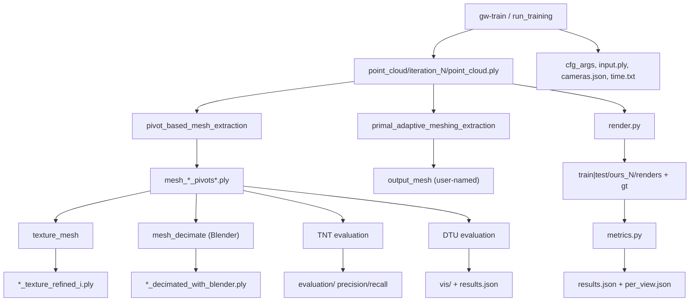

# Outputs & Artifacts Reference

> Source of truth: `gaussian_wrapping/train.py`, `gaussian_wrapping/scene/__init__.py`,
> `gaussian_wrapping/scene/gaussian_model.py` (`save_ply`, `construct_list_of_attributes`),
> `gaussian_wrapping/pivot_based_mesh_extraction.py`,
> `gaussian_wrapping/primal_adaptive_meshing_extraction.py`,
> `gaussian_wrapping/texture_mesh.py`, `gaussian_wrapping/mesh_decimate.py`,
> `gaussian_wrapping/render.py`, `gaussian_wrapping/metrics.py`,
> `gaussian_wrapping/convert.py`, `gaussian_wrapping/eval/tnt/*`,
> `gaussian_wrapping/eval/dtu/eval.py`, `gaussian_wrapping/evaluate_dtu_mesh.py`,
> `gaussian_wrapping/scripts/train_and_extract_gw_*.py`.

Every task and script in the project writes its results into (or next to) the
**model directory** (`-m` / `model_path`). This document lists every file that
can appear there, what wrote it, what it contains, and what it means. The
companion `GW_experiments` harness adds two more artifacts to the same
directory plus SLURM logs — see the last section.

## Where outputs live

```
<model_path>/                      # the central artifact directory
├── cfg_args                       # training settings (written at startup)
├── input.ply                      # initial point cloud
├── cameras.json                   # camera metadata
├── points3D.ply                   # (only with save_init_ply)
├── time.txt                       # wall-clock training time
├── point_cloud/iteration_<N>/point_cloud.ply
├── chkpnt<N>.pth                  # (only with checkpoint_iterations)
├── mesh_*.ply                     # mesh extraction outputs
├── *_texture_refined_<i>.ply      # texture refinement outputs
├── *_decimated_with_blender.ply   # decimation output
├── train/ ours_<N>/{renders,gt}/  # render.py outputs
├── results.json, per_view.json    # metrics.py outputs
├── vis/                           # DTU evaluation outputs
├── evaluation/                    # TNT evaluation outputs (next to the mesh)
├── train.log                      # (GW_experiments) training stdout/stderr mirror
└── run_manifest.json              # (GW_experiments) reproducibility record
```

Exception: `convert.py` writes into the **dataset** directory (see
[Dataset-side outputs](#dataset-side-outputs-convertpy)) — it is the only
script that modifies the dataset.



---

## 1. Training outputs (`gw-train` / `run_training`)

| File | Written when | Contents / meaning |
|------|--------------|--------------------|
| `cfg_args` | Startup (`prepare_output_and_logger`) | `repr` of the dataset (`ModelParams`) namespace, e.g. `Namespace(sh_degree=3, source_path='...', model_path='...', images='images', resolution=-1, ...)`. This is the **machine-readable record of how the model was trained**; every downstream script (`render.py`, extraction, evaluation) reads it via `get_combined_args` and merges it with its own CLI flags (explicitly-passed flags win). If `model_path` was empty at startup, a unique `./output/<10-char-uuid>` directory is generated instead (or `./output/<OAR_JOB_ID>` under the OAR scheduler). |
| `input.ply` | `Scene.__init__`, first load only | The initial point cloud the Gaussians start from (positions + RGB colors). Built **in memory** from the COLMAP/Blender data — the dataset itself is never written to. When resuming a saved iteration (`loaded_iter`), it is not rewritten. |
| `cameras.json` | `Scene.__init__`, first load only | One JSON entry per camera (train + test): id, image name, resolution, position, rotation, focal lengths. Consumed by viewer tools (e.g. the SIBR viewer / network GUI) to reproduce training viewpoints. |
| `points3D.ply` | `Scene.__init__`, only with `save_init_ply: true` | A second copy of the initial point cloud kept in the model directory (the experiments harness uses this to inspect what was initialized without touching the dataset). |
| `point_cloud/iteration_<N>/point_cloud.ply` | At every `save_iterations` value, and always at the final iteration | **The trained model.** A binary PLY of all Gaussians; attributes listed below. This is the input artifact for mesh extraction, rendering and evaluation. |
| `chkpnt<N>.pth` | At every `checkpoint_iterations` value | `torch.save((gaussians.capture(), iteration))` — full model **and optimizer** state. Resume with `--start_checkpoint <path>`; regularizer schedules shift past the checkpoint iteration automatically. |
| `time.txt` | End of run (CLI `main()` and `run_training`) | Wall-clock training duration in seconds, as a plain string (e.g. `7312.4821…`). |
| `wandb/` | Only when WandB is configured (`wandb_project` + `wandb_entity`) | Created by `wandb.init` in the **current working directory** (not the model directory): online logs of the losses and test metrics. |

### The trained-model PLY (`point_cloud.ply`) attribute layout

Written by `GaussianModel.save_ply` / `construct_list_of_attributes`:

| Attributes | Always? | Meaning |
|------------|---------|---------|
| `x, y, z` | yes | Gaussian center positions |
| `nx, ny, nz` | yes | Placeholder normals, **written as zeros** (the real normals live in the learnable features below) |
| `f_dc_0..2` | yes | DC spherical-harmonics band (base color) |
| `f_rest_0..44` | yes for `sh_degree=3` | Remaining SH bands; count is `3·((sh_degree+1)² − 1)` (45 for degree 3, 33 for degree 2, 21 for degree 1, 9 for degree 0) |
| `opacity` | yes | Pre-activation opacity (sigmoid unless `use_unbounded_opacity`, then log-space) |
| `scale_0..2` | yes | Log-space scales |
| `rot_0..3` | yes | Rotation quaternion |
| `filter_3D` | when the 3D mip filter is active (default) | Per-Gaussian anti-aliasing filter coefficient (Mip-Splatting-style) |
| `base_occupancy_0..`, `occupancy_shift_0..` | when MILo is enabled (`learn_occupancy`) | Learnable occupancy field used for mesh extraction |
| `gaussian_features_0..` | when the normal field is enabled | The learnable normal-field features (1 feature with `use_smallest_axis`, else 4) |

> Note: `load_ply` re-derives the model's feature flags from the PLY
> attributes present, so a saved PLY fully determines how the model reloads.

---

## 2. Pivot-based mesh extraction outputs (`pivot_based_mesh_extraction.py`)

Output name is composed from the extraction settings:

```
mesh_{sdf_mode}_{n_pivots}pivots{iso_suffix}[_scores][_searched][_post].ply
```

| Name component | Meaning |
|----------------|---------|
| `sdf_mode` | `"ours"` (fast approximate SDF from rendered depth/transmittance) or `"exact_computation"` (exact transmittance evaluation) |
| `{n_pivots}pivots` | Number of pivots per Gaussian used for tetrahedralization (default 2) |
| `iso_suffix` | `_transmittance_threshold_<t>` when `sdf_mode=exact_computation` and the threshold ≠ 0.5; `_iso_<v>` when `isosurface_value ≠ 0`; empty otherwise |
| `_scores` | Appended with `--use_scores`: mesh carries per-vertex quality scores |
| `_searched` | Appended with `--use_searched_pivots`: pivots were optimized (searched) before tetrahedralization — the end-to-end wrappers always use this |
| `_post` | Appended when `--postprocess` is set: floaters and disconnected components removed (`post_process_mesh`) |

All variants are **triangle meshes with per-vertex colors** (evaluated from the
trained Gaussians), written into the model directory. The canonical end-to-end
product of the wrappers is `mesh_exact_computation_2pivots_searched_post.ply`
(RaDe-GS wrapper) or `mesh_ours_2pivots_searched_post.ply` ("ours" wrapper).

---

## 3. Primal Adaptive Meshing outputs (`primal_adaptive_meshing_extraction.py`)

| File | Written when | Contents / meaning |
|------|--------------|--------------------|
| `<--output_mesh>` | Always (path is **required** and user-chosen — no default naming) | The extracted triangle mesh (PLY or OBJ per the extension). Occupancy-based surface via candidate-point refinement + Delaunay + marching tetrahedra. |
| `<output_mesh without .ply>_candidate_points.ply` | With `--save_candidate_points` | The refined candidate points the surface was built from (debugging/analysis). |
| `histogram_occupancy_values_<i>.png` | With `--plot_vacancy_histogram`, into the model directory | Per-refinement-step histograms of occupancy values with the iso-surface value marked — used to tune `--iso_surface_value`. |

---

## 4. Post-processing outputs

### `texture_mesh.py`

```
<model_path>/<mesh_name>_texture_refined_<i_iter>.<ext>
```

- `<mesh_name>` is the basename of `--mesh` without extension (e.g. meshing
  `mesh_ours_2pivots_searched_post.ply` produces
  `mesh_ours_2pivots_searched_post_texture_refined_999.ply`).
- `<i_iter>` is the **final** refinement loop index, i.e. `n_iter − 1`
  (default `n_iter=1000` → `..._999`). Only the last iteration's file remains
  from the final loop; each iteration overwrites the previous index.
- The refinement optimizes the Gaussians' SH color features against the
  training views and bakes them into per-vertex colors of the mesh.

### `mesh_decimate.py` (runs inside Blender)

```
<in_path with .ply replaced by>_decimated_with_blender.ply
```

- Default output path only; the `--out` argument is parsed but **broken**
  (passing it raises `NameError`) — see the known-issues list in `AGENTS.md`.
- The end-to-end wrappers call this between extraction and texturing when a
  `--decimate_ratio` is given, and continue from the decimated file.

---

## 5. End-to-end wrapper outputs (`scripts/train_and_extract_gw_*.py`)

The wrappers chain training → extraction → (optional decimation) → texture
refinement, so a full run leaves this artifact trail in the model directory:

| Step | Artifacts |
|------|-----------|
| 1. Train | `cfg_args`, `input.ply`, `cameras.json`, `point_cloud/iteration_30000/point_cloud.ply`, `time.txt` |
| 2. Extract | `mesh_exact_computation_2pivots{iso}_searched.ply` (RaDe-GS wrapper, `--sdf_mode exact_computation --use_searched_pivots`) or `mesh_ours_2pivots{iso}_searched.ply` ("ours" wrapper, `--sdf_mode ours`); plus `_post.ply` when post-processing is on |
| 2.5 Decimate (optional) | `<previous mesh>_decimated_with_blender.ply` |
| 3. Texture refine | `<mesh used>_texture_refined_<n_iter−1>.ply` — the final deliverable |

---

## 6. Rendering outputs (`render.py`)

```
<model_path>/{train|test}/ours_<iteration>/renders/00000.png, 00001.png, …
<model_path>/{train|test}/ours_<iteration>/gt/00000.png, 00001.png, …
```

- `renders/` — the trained model rendered from every camera of the split;
  `gt/` — the corresponding ground-truth images, same indices, for side-by-side
  comparison and as input to `metrics.py`.
- `--skip_train` / `--skip_test` select the split; `--iteration` picks the
  checkpoint (default 30000). Settings are merged from `cfg_args`.
- Note: `render.py` defaults to `--rasterizer radegs` (the API's
  `GaussianWrappingScene.render` defaults to `"ours"` — intentional).

## 7. Metrics outputs (`metrics.py`)

Per model directory passed via `-m` (multiple allowed):

| File | Contents |
|------|----------|
| `results.json` | Aggregate rendering metrics over the rendered set: PSNR, SSIM, LPIPS (Alex; VGG variants where computed) |
| `per_view.json` | The same metrics **per image**, for per-view analysis |

Both are also printed as a table to stdout. They are computed from the
`renders/` vs `gt/` PNGs produced by `render.py` (or any matching directory
layout).

---

## 8. Benchmark evaluation outputs

### Tanks and Temples (`eval/tnt/run.py` → `eval/tnt/evaluation.py`)

Output directory: `--out_dir`, default `<directory of the evaluated mesh>/evaluation`.

| File | Contents |
|------|----------|
| `<scene>.precision.ply` | Point cloud sampled from the reconstructed mesh, colorized by point-to-point distance to the GT (accuracy error, colormap scaled to `3 × threshold`) |
| `<scene>.recall.ply` | GT point cloud colorized by distance to the reconstruction (completeness error) |
| `<scene>.precision.txt`, `<scene>.recall.txt` | Cumulative distance curves (saved with `np.savetxt`) behind the precision/recall/F-score computation |

Precision, recall and F-score at the chosen threshold, plus mean distances,
are printed to stdout (not written to a file). The evaluation needs the TNT
ground-truth files (`<scene>.ply`, `<scene>.json` crop, `<scene>_trans.txt`
alignment, `<scene>_COLMAP_SfM.log` trajectory) in `--dataset_dir`, provided by
the TNTUniScanEvals submodule setup.

### DTU (`evaluate_dtu_mesh.py` → `eval/dtu/eval.py`)

| File | Written by | Contents |
|------|-----------|----------|
| `<model_path>/recon_aligned.ply` | `evaluate_dtu_mesh.py` | The input mesh (hard-coded name `recon_post.ply` — see known issues) after alignment to the DTU coordinate frame |
| `<model_path>/vis/vis_<scan:03>_d2s.ply` | `eval/dtu/eval.py` | Reconstruction sampled and colorized by distance-to-scan (accuracy) |
| `<model_path>/vis/vis_<scan:03>_s2d.ply` | `eval/dtu/eval.py` | GT scan sampled and colorized by distance-to-reconstruction (completeness) |
| `<model_path>/vis/results.json` | `eval/dtu/eval.py` | `{"mean_d2s": …, "mean_s2d": …, "overall": (mean_d2s + mean_s2d) / 2}` — the standard DTU Chamfer distances |

Mean distances are also printed to stdout. `eval/dtu/eval.py` can also run in
`--mode pcd` on point clouds, and needs the DTU evaluation data
(`Points/stl/stl<scan:03>_total.ply` and calibration files) under `--dataset_dir`.

---

## 9. Dataset-side outputs (`convert.py`)

`python -m gaussian_wrapping.convert -s <dataset>` prepares a RAW COLMAP
capture for training. **It writes into the dataset directory**:

| Path | Contents |
|------|----------|
| `<dataset>/distorted/` | COLMAP `image_undistorter` output: undistorted images + a distorted-corrected sparse model (`distorted/sparse`) |
| `<dataset>/sparse/0/` | The final undistorted model converted back to COLMAP bin format (`cameras.bin`, `images.bin`, `points3D.bin`) — the layout training expects |
| `<dataset>/images_2/`, `images_4/`, `images_8/` | Optional downscaled image copies (used with `--resolution`-style training at reduced scale) |

Run this once per dataset before training; training itself never writes into
the dataset.

---

## 10. `GW_experiments` harness artifacts

The experiment harness (`scripts/train_gw.py`) adds two artifacts to the model
directory and writes SLURM logs in the repo:

| File | Contents / meaning |
|------|--------------------|
| `<model_path>/train.log` | Line-buffered mirror of everything the **training API** writes to stdout/stderr during the run (the experiment logger's own lines go only to the SLURM log). Disabled with `--no-log-file`, relocatable with `--log-file`. |
| `<model_path>/run_manifest.json` | Reproducibility record, written **before** output validation (and also written with `returncode: 1` when `run_training` raises). Schema v1 keys: `schema_version`, `experiment` (name), `task` (`"train"`), `started_at`/`finished_at` (UTC ISO), `duration_seconds`, `returncode`, `command`, `log_path`, `config` (the full resolved nested config), `api_kwargs` (the exact `TrainingConfig` kwargs), `environment` (python version/executable, platform, hostname, cwd, `SLURM_JOB_ID`/`SLURM_JOB_NAME`/`SLURM_ARRAY_TASK_ID`/`SLURM_NODELIST`/`CUDA_VISIBLE_DEVICES` when present, `gaussian_wrapping_version`, `torch_version`, `cuda` info), `outputs` (per-file `exists`/`size_bytes` for the five expected artifacts + `missing` list). Written atomically (`.tmp` + rename). Disabled with `--no-manifest`. |
| `logs/gw_train_<jobid>.out` / `.err` | SLURM stdout/stderr of the job (`logs/%x_%j.out`/`.err` in `slurm/train_gw.slurm`). Contains the experiment logger's stage sections, pre-flight report, and the formatted error (with hint) on failure. |

The five artifacts the harness validates after every run (exit 5 if any is
missing): `cfg_args`, `input.ply`, `cameras.json`,
`point_cloud/iteration_<N>/point_cloud.ply`, `time.txt`.

Full manifest schema and field-by-field meaning:
`GW_experiments/docs/utils-reference.md`.

---

## 11. What is *not* written to disk

- **MILo's in-the-loop meshes** — extracted every N iterations during training
  for the mesh-in-the-loop loss, but kept in memory only; nothing is saved.
- **The dataset** — training, extraction, rendering and evaluation never write
  into the dataset directory (only `convert.py` does, deliberately).
- **Depth/normal maps** — the rasterizers produce expected/median depth and
  normals as tensors for the losses; no script currently persists them.

## Quick reference: script → outputs

| Script | Writes |
|--------|--------|
| `gw-train` / `run_training` | `cfg_args`, `input.ply`, `cameras.json`, (`points3D.ply`), `point_cloud/iteration_<N>/point_cloud.ply`, `chkpnt<N>.pth`, `time.txt` |
| `pivot_based_mesh_extraction.py` | `mesh_<sdf_mode>_<n>pivots<iso>[_scores][_searched][_post].ply` |
| `primal_adaptive_meshing_extraction.py` | `--output_mesh` (+ `_candidate_points.ply`, occupancy histograms) |
| `texture_mesh.py` | `<mesh>_texture_refined_<n−1>.<ext>` |
| `mesh_decimate.py` | `<mesh>_decimated_with_blender.ply` |
| `train_and_extract_gw_*.py` | All of the above, chained |
| `render.py` | `{train,test}/ours_<N>/{renders,gt}/*.png` |
| `metrics.py` | `results.json`, `per_view.json` |
| `eval/tnt/run.py` | `evaluation/<scene>.{precision,recall}.{ply,txt}` + stdout metrics |
| `evaluate_dtu_mesh.py` | `recon_aligned.ply`, `vis/vis_<scan>_{d2s,s2d}.ply`, `vis/results.json` |
| `convert.py` | `<dataset>/distorted/`, `<dataset>/sparse/0/`, optional `images_{2,4,8}/` |
| `scripts/train_gw.py` (GW_experiments) | `train.log`, `run_manifest.json` (+ SLURM logs in `logs/`) |
